Esta página cierra la fase de **comprensión de los datos** de CRISP-DM. El análisis se hace sobre los datos **crudos** (antes de limpiar), porque lo que encontremos aquí decide qué hay que limpiar en la [preparación](preparacion.qmd).

::: {.caja .caja-clave}
[Cómo se reproduce]{.etiqueta}
Todas las tablas y figuras de esta página las genera el paso `calidad` del [pipeline](pipeline.qmd) (`python pipeline/run_pipeline.py`). Las tablas se incluyen desde `tablas/*.md`: si los datos cambian, la página se actualiza sola al volver a correr el pipeline.
:::

## 1.1 Datos de partida

El **dataset analítico** une las fuentes de E1 al grano declarado: **una fila por estación-línea del Metro por día**. Antes de analizarlo solo se hicieron tres cosas, las mínimas para poder leerlo: convertir la fecha a tipo fecha, convertir la afluencia a número y reparar la doble codificación del texto (`Línea 1` → `Línea 1`).

| Característica | Valor |
|----------------|-------|
| Filas | **1,180,920** (195 estaciones-línea × 6,056 días, sin huecos) |
| Variables | **13** (tabla siguiente) |
| Periodo | 2010-01-01 a 2026-07-31 |
| Territorio | Red del STC Metro: 12 líneas, 163 estaciones físicas y 195 estaciones-línea (las de transbordo cuentan una vez por línea), en la Ciudad de México y en Ecatepec, Nezahualcóyotl y La Paz (Estado de México). El clima es un solo punto de malla en el centro de la ciudad |

| Variable | Fuente | Tipo | Regla de integración |
|----------|--------|------|----------------------|
| `fecha` | F1 | fecha | Llave temporal |
| `linea_codigo` | F1 | categórica (12) | Código extraído del texto de la línea |
| `estacion` | F1 | categórica (195 con la línea) | Texto reparado; sin unificar todavía |
| `afluencia` | F1 | numérica discreta ≥ 0 | Entradas registradas en el día |
| `anio`, `dia_semana`, `periodo` | derivadas de `fecha` | categóricas | Periodo: 2010-2019, 2020-2021 (pandemia), 2022-2026 |
| `precipitacion_mm`, `lluvia_mm`, `temp_max_c`, `temp_min_c` | F5 | numéricas | Un valor por día para toda la ciudad, repetido en las 195 estaciones |
| `categoria_lluvia` | derivada de F5 | categórica ordinal (4) | Escala del SMN para 24 h: sin lluvia < 0.1 mm, ligera < 5.1, moderada < 25, fuerte ≥ 25 |
| `es_festivo_f4` | F4 | binaria | Festivo según Nager.Date, tal como viene |

**Regla de agregación.** Ninguna fuente es más fina que el grano: todas son diarias. Clima y festivos son más gruesos (un valor por día para la ciudad) y se repiten en cada estación. Además del grano estación-día, analizamos dos fuentes a su granularidad original: la **red completa por día** (suma de las 195 estaciones) y el **Metrobús por línea y día** (F2).

### Diagnóstico inicial de calidad

**Tabla 1.** Lo que traen las fuentes antes de tocarlas. Cada problema tiene su tratamiento en el [registro de limpieza](preparacion.qmd#registro-de-limpieza).



## 1.2 Estadística descriptiva en las cuatro dimensiones

**Tabla 2.** Localización, variabilidad y forma de las variables numéricas (datos crudos).



**Localización: la media engaña.** En una estación-día típica entran **14,426 personas** (mediana), pero la media es de **19,608**: es 36 % mayor porque unas cuantas estaciones muy cargadas jalan el promedio hacia arriba. La media recortada al 10 % (16,321) queda entre las dos. La **moda es 0**: el valor más repetido de toda la base es "nadie entró", y eso por sí solo ya es un hallazgo (sección 1.6). Sin los ceros, la mediana sube a 15,299.

**Variabilidad: colas largas.** La desviación estándar (19,290) es mayor que el rango intercuartil (17,885). En una distribución normal la desviación sería de unas tres cuartas partes del IQR; aquí lo supera, señal de valores extremos. La asimetría de 2.59 y la curtosis de 9.5 lo confirman. El percentil 99 (105,176) es más de 7 veces la mediana. Por eso para comparar estaciones usamos **mediana e IQR**, no media y desviación.

**La red completa se comporta al revés.** La suma diaria de la red tiene la media (3.82 millones) **por debajo** de la mediana (4.01 millones) y asimetría negativa (−0.44). La cola está a la izquierda: días con muy poca gente por la pandemia, los cierres y los festivos.

**Clima.** La lluvia es la variable más sesgada: la mediana es de 0.3 mm y la media de 3.0 mm (diez veces más), y el 42.5 % de los días no llueve. La temperatura máxima es casi simétrica (asimetría 0.23) y poco variable (CV de 0.14).

### Comparación por grupos

**Tabla 3.** Entradas por estación-día según la línea, 2022-2026, ordenadas por mediana.



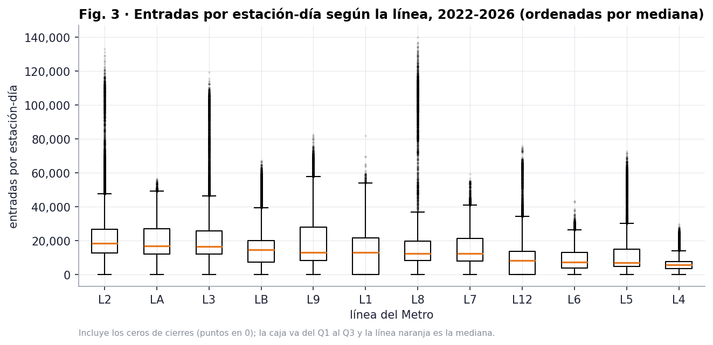

La **Línea 2** tiene la estación-día mediana más cargada (18,395) y concentra el 17.3 % de las entradas de la red. La **Línea 4**, la más ligera, tiene una mediana tres veces menor (5,852). La **Fig. 3** muestra dos cosas que la media escondería: las Líneas 2, 3 y 8 tienen cajas parecidas pero colas muy largas, por terminales como Cuatro Caminos, Indios Verdes y Constitución de 1917. Las Líneas 1 y 12 tienen el Q1 pegado a cero por sus cierres de 2022-2025 (10,996 y 10,730 ceros), lo que infla su IQR y su CV.

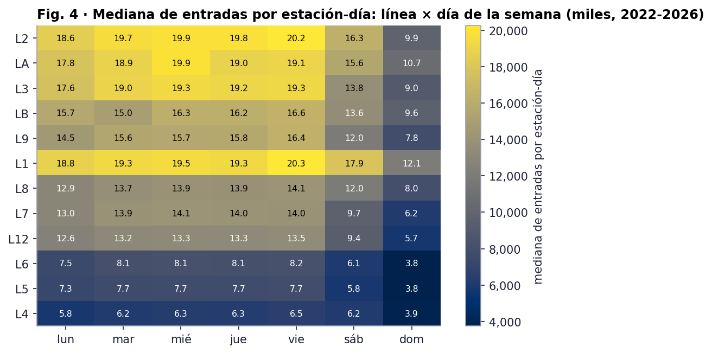

La **Fig. 4** cruza línea y día de la semana (es la vista que pedía P1 desde E0). En todas las líneas el patrón es el mismo: de lunes a viernes la mediana es estable, el sábado baja y el domingo cae a la mitad. Lo que cambia entre líneas es el tamaño del fin de semana. La Línea 4 conserva el sábado (6.2 mil, más que su lunes de 5.8 mil); la Línea 7 lo pierde (9.7 mil contra 14 mil entre semana).

**Tabla 4.** Entradas diarias a la red por día de la semana (2022-2026, sin días en cero).



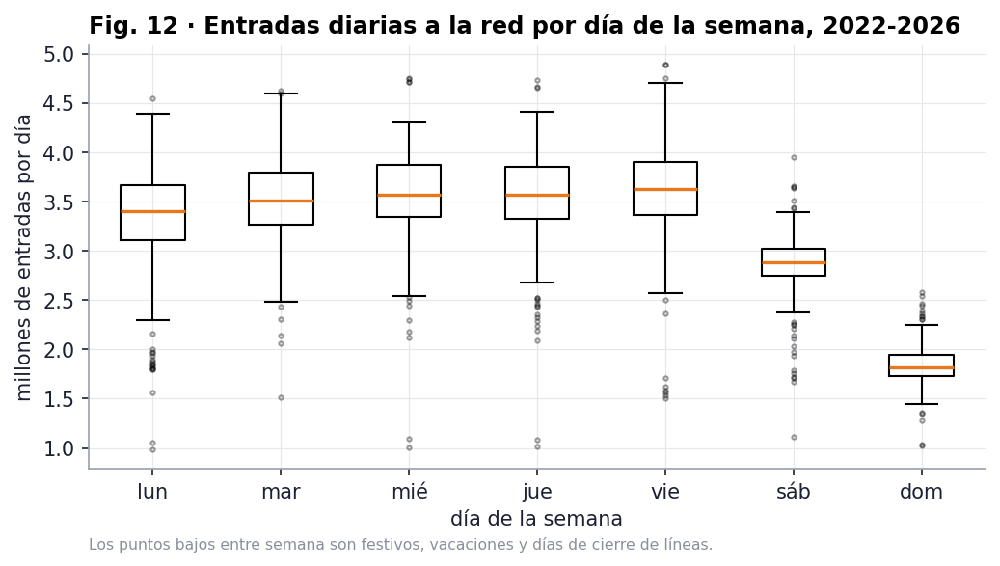

El domingo la red recibe el **51 %** de lo que recibe un día entre semana; el sábado, el **81 %**. El lunes queda ligeramente abajo (96 %) porque los festivos del calendario legal caen en lunes. Los puntos aislados abajo de cada caja en la **Fig. 12** son festivos, vacaciones y días con líneas cerradas.

**Tabla 5.** La red por periodo.



La mediana diaria de la red pasó de **4.79 millones** (2010-2019) a **2.29 millones** (pandemia) y solo se ha recuperado a **3.35 millones** (2022-2026), un 30 % por debajo del nivel previo. El porcentaje de ceros subió de 4.2 % a 7.1 % por las obras de las Líneas 1, 9 y 12.

## 1.3 Concentración: Gini y curva de Lorenz

Aplicamos el coeficiente de Gini a dos variables del proyecto. Antes, tres declaraciones que cambian el resultado:

- **Unidad de agregación.** Se calcula sobre el total anual de entradas por **estación-línea** (195 unidades) y, por separado, por **línea** (12 del Metro y hasta 7 del Metrobús).
- **Ceros.** Una estación con 0 entradas en todo el año (la Línea 12 antes de abrir y durante 2022, cuando estuvo cerrada todo el año) **se excluye** de ese año: no es una estación con poca demanda, es una estación que no existía o no operaba. Los ceros de días sueltos sí cuentan, porque forman parte del total anual.
- **Conteos absolutos y no tasas.** El operador dimensiona trenes y personal según cuántas personas entran, no según una tasa. Además no existe un denominador público (capacidad o población del entorno) por estación.

**Tabla 6.** Gini por año.



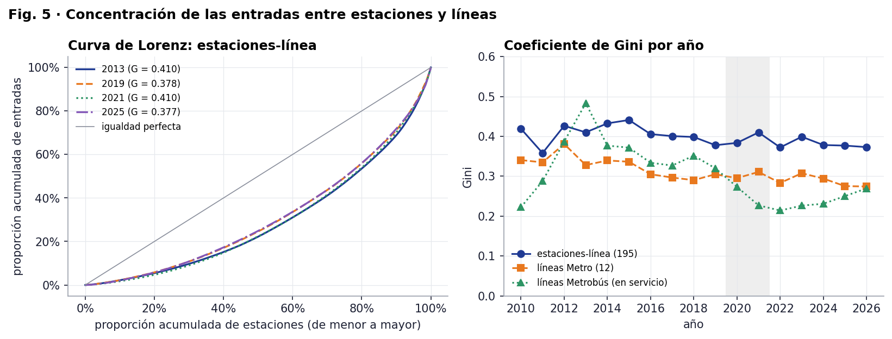

**Lectura.** En 2025 el Gini entre estaciones es de **0.377**, y el 10 % de las estaciones más cargadas (20 de 195) recibe el **28.6 %** de todas las entradas. Es una concentración moderada y muy **estable**: el Gini se ha movido entre 0.36 y 0.44 en 16 años, y las curvas de Lorenz de 2013, 2019, 2021 y 2025 casi se enciman (**Fig. 5**). Para P1 esto significa que los picos absolutos siempre caen en las mismas estaciones grandes. Si el umbral de "alta demanda" fuera un número fijo de entradas, solo esas estaciones alcanzarían a tocarlo. Por eso el umbral se define **contra la base de cada estación** (sección 1.5).

Entre las **líneas del Metrobús** la concentración bajó mucho: de 0.48 en 2013 a 0.21 en 2022. Las líneas nuevas maduraron y la demanda se repartió (P5).

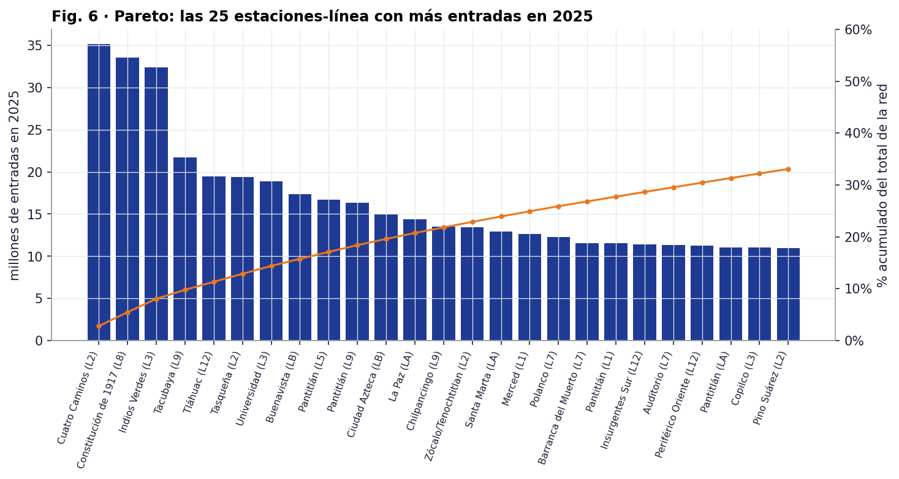

El diagrama de Pareto (**Fig. 6**) nombra a las estaciones: Cuatro Caminos (L2), Constitución de 1917 (L8) e Indios Verdes (L3) recibieron más de 32 millones de entradas cada una en 2025. Las tres son terminales que conectan con el transporte del Estado de México. Pantitlán aparece cuatro veces porque es estación de cuatro líneas.

**Segunda variable: la lluvia.** La precipitación diaria está mucho más concentrada que la demanda.

**Tabla 7.** Concentración de la lluvia por año.



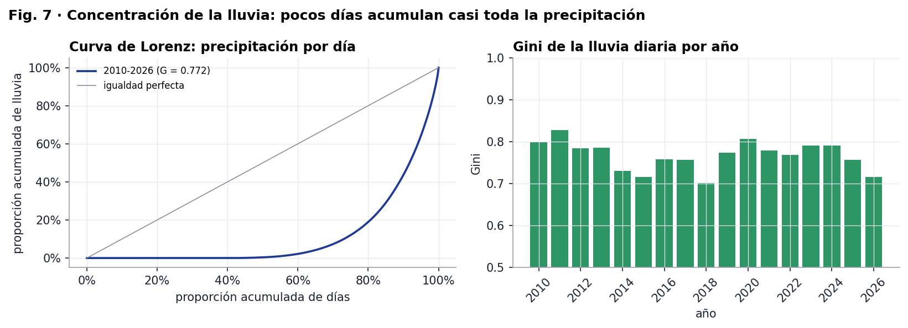

El Gini de la lluvia diaria en 2010-2026 es de **0.772**. El 10 % de los días más lluviosos acumula el **56.4 %** de toda la precipitación, y el 42.5 % de los días no llueve nada (el tramo plano de la curva en la **Fig. 7**). Para P2 y P4 esto implica que, si la lluvia afecta la demanda, lo hará en pocos días. Una variable continua con tantos ceros se describe mejor por categorías, y por eso se conserva `categoria_lluvia`.

*Precaución: este Gini mide concentración de una variable. No es la "impureza de Gini" que usan los árboles de decisión, que se verá en el modelado.*

## 1.4 Heterogeneidad: entropía normalizada

**Tabla 8.** Entropía normalizada ($H_{norm} = H / \log_2 K$) de variables categóricas.



**Lectura.** Se pueden comparar porque están normalizadas entre 0 y 1:

- **Línea.** Las estaciones se reparten casi por igual entre las 12 líneas ($H_{norm}$ = 0.982), pero las **entradas** un poco menos (0.948): la demanda está más concentrada que la infraestructura. Es la misma conclusión del Gini, vista desde las categorías.
- **Categoría de lluvia.** Es la variable más heterogénea entre temporadas: en secas (diciembre a marzo) el 73 % de los días caen en "sin lluvia" ($H_{norm}$ = 0.50), y en lluvias (junio a septiembre) los días se reparten entre las cuatro categorías ($H_{norm}$ = 0.76). Comparar la entropía **por temporada** muestra lo que el valor global (0.79) esconde (**Fig. 9**).
- **Tipo de registro** (positivo o cero): $H_{norm}$ = 0.30, porque el 94.7 % de las filas son positivas.

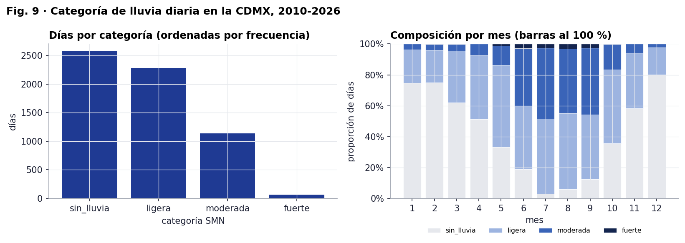

**Entropía del perfil semanal de cada estación (P3).** Para cada estación calculamos qué parte de su demanda cae en cada día de la semana y la entropía de ese reparto.

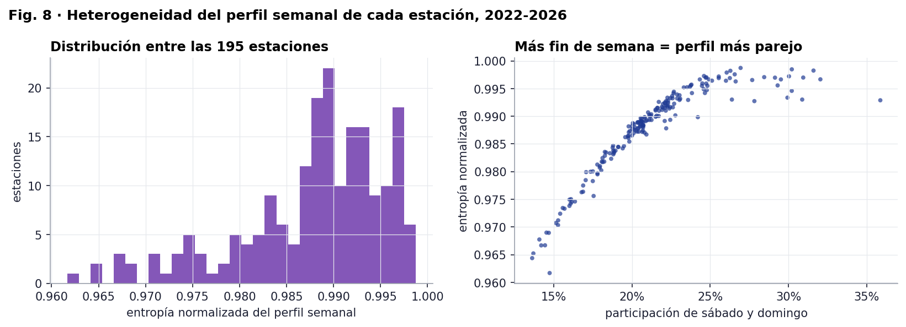

**Tabla 9.** Las cinco estaciones con el perfil semanal más concentrado y las cinco con el más parejo.



Todas las estaciones tienen una entropía alta (de 0.962 a 0.999), porque ninguna cierra en fin de semana. Las diferencias son pequeñas pero ordenan a las estaciones con claridad (**Fig. 8**, derecha):

- **Perfil concentrado** (entropía baja): estaciones de trabajo, como Norte 45, Niños Héroes (juzgados) y Hospital 20 de Noviembre. Ahí sábado y domingo reciben solo el 14 % de la semana.
- **Perfil parejo** (entropía alta): estaciones de paseo y viaje, como La Villa/Basílica, Autobuses del Norte y Bosque de Aragón. Ahí el fin de semana llega al 26-32 %.

La entropía no depende del tamaño de la estación (ρ de Spearman = −0.05 contra la media diaria). Esto es justo lo que necesita P3: los perfiles existen y son independientes del volumen. Como la escala de la entropía queda muy comprimida, para el clustering conviene usar las participaciones por día y no la entropía sola (ver el [PCA](preparacion.qmd#pca)).

## 1.5 Series, ceros, lluvia y el umbral de alta demanda

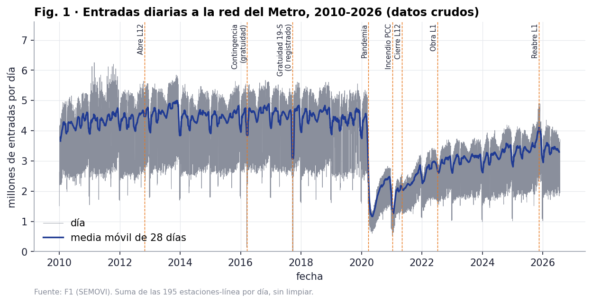

La **Fig. 1** es la serie completa de la red. Se ven cuatro cosas:

1. Un patrón semanal muy marcado (la banda gris).
2. La caída de la **pandemia** en 2020, de la que la red no se ha recuperado.
3. Dos huecos que no son demanda. En **marzo de 2016** y **septiembre de 2017** la red registra casi cero o cero exacto, y coinciden con días en que el transporte fue gratuito: la contingencia ambiental de 2016 y los días posteriores al sismo del 19-S. Las fuentes de prensa están al final de la página.
4. El efecto de las obras de las Líneas 1 y 12 a partir de 2021-2022.

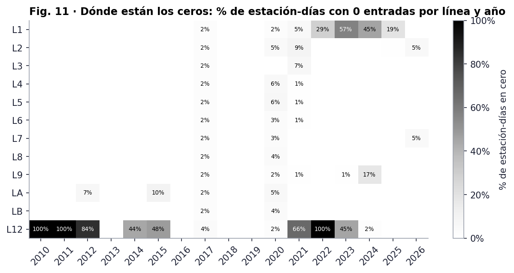

La **Fig. 11** ubica los 62,025 ceros. Se ven en bloques: la Línea 12 antes de abrir (2010-2012), su cierre de 2014-2015 y el de 2021-2024, y la Línea 1 en 2022-2025. Además hay una franja vertical de 2 % en todas las líneas en 2017: los 8 días de gratuidad tras el sismo. Los ceros se agrupan por línea y periodo, no al azar: **no son faltantes aleatorios**, y cada patrón tiene una explicación distinta.

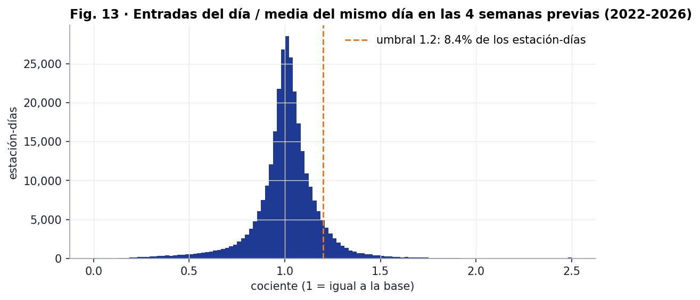

**El umbral de alta demanda (de P1 a P2).** E1 dejó el umbral provisional en 1.20 × la línea base ingenua (la media del mismo día de la semana en las 4 semanas previas, que es la base del criterio de éxito). La **Fig. 13** muestra la distribución de ese cociente en 2022-2026. Está centrada en 1.01: la base ingenua acierta en promedio. Su percentil 90 es 1.18 y el 95 es 1.26. Con el umbral en **1.20**, el **8.4 %** de los estación-días son de alta demanda: un evento poco frecuente pero no raro. **Se mantiene 1.20.** Subirlo a 1.26 (P95) dejaría muy pocos positivos para medir recall y precisión.

**Tabla 10.** Proporción de estación-días de alta demanda por año.



La proporción baja de 10.7 % (2022) a 7.0 % (2025): mientras la red se recuperaba de la pandemia, cada semana superaba a las anteriores con más frecuencia. Para el modelado esto significa una clase minoritaria de alrededor del 8 %, que se tratará dentro de la partición de entrenamiento (nunca antes de separar).

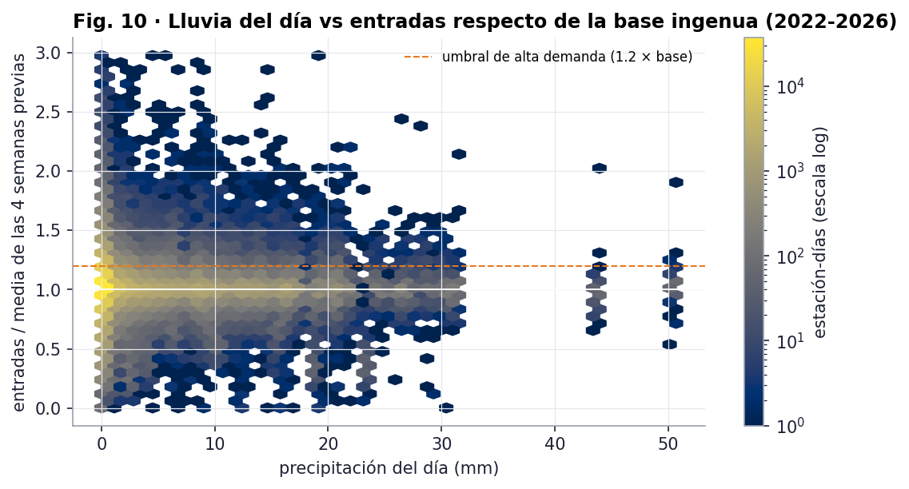

**Tabla 11.** Cociente contra la base según la lluvia del día (2022-2026).



**Resultado negativo: la lluvia casi no mueve la demanda diaria.** La correlación de Spearman entre la precipitación y el cociente contra la base es de **−0.06**. Es significativa solo por el tamaño de la muestra (n = 303,120): la nube de la **Fig. 10** es horizontal. Lo único visible es que con lluvia fuerte hay **menos** días de alta demanda (3.8 % contra 10.1 % en días secos): la lluvia, si acaso, resta pasajeros.

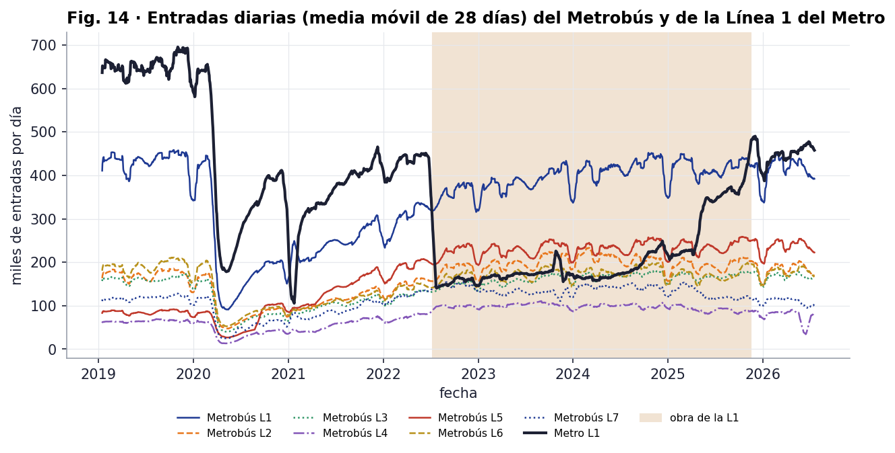

**P5: Metrobús y el cierre de la Línea 1.** La **Fig. 14** muestra la caída de la Línea 1 durante la obra (de unos 430 mil a 210 mil entradas diarias) y su recuperación al reabrir. El Metrobús subió durante el cierre, pero también subieron las demás líneas del Metro, porque toda la red seguía recuperándose de la pandemia. El [resultado del DataMart](pipeline.qmd#resultados-del-datamart) separa los periodos.

## 1.6 Hallazgos

**Tabla 12.** Hallazgos del EDA vinculados a las preguntas de E0.

| # | Hallazgo | Evidencia | Tipo | Vínculo con E0 | Consecuencia |
|---|----------|-----------|------|----------------|--------------|
| **H1** | El 10 % de las estaciones recibe el 28.6 % de las entradas (Gini 0.377 en 2025), y esa concentración casi no cambió en 16 años (0.36-0.44) | Tabla 6, Figs. 5 y 6 | Esperado | **P1** se refuerza: los picos absolutos son siempre las mismas terminales. Un umbral fijo solo marcaría estaciones grandes | El umbral de alta demanda se define **contra la base de cada estación** (1.20 × base, Fig. 13); se conserva la granularidad por estación |
| **H2** | Los 62,025 ceros no son un solo fenómeno: 33.5 % son la L12 antes de abrir, 63.2 % son cierres de 7 días o más, 0.8 % son cierres de un día y 2.5 % caen en **10 días en que no se midió** (gratuidad de 2016 y 2017) | Fig. 1, Fig. 11, registro L17-L20 | **Inesperado** | **P2, P4.** E0 (riesgo R3) suponía que los ceros eran cierres de obra. Los días de gratuidad no son demanda cero: si se dejaran, el modelo aprendería que tras un sismo nadie viaja | Tratamiento distinto para cada tipo: NULL en los días sin medición (`es_dia_sin_medicion`), versiones SCD2 para los cierres y la marca `es_registro_cero` para los de un día |
| **H3** | La lluvia casi no cambia la demanda diaria (ρ = −0.06); con lluvia fuerte hay **menos** días de alta demanda (3.8 % contra 10.1 %) | Fig. 10, Tabla 11 | **Negativo** | **P2** pierde una variable candidata; **P4** casi no podrá atribuir anomalías a la lluvia (0.9 % de las anomalías, ver DataMart) | Se conserva la precipitación para que E3 mida su aporte; se descarta `lluvia_mm` (idéntica a la precipitación) |
| **H4** | La red no recuperó su nivel previo a la pandemia: mediana de 3.35 millones al día en 2022-2026 contra 4.79 millones en 2010-2019 (−30 %) | Tabla 5, Fig. 1 | Esperado (riesgo R5 de E0) | **P2:** mezclar periodos sesgaría el pronóstico | El dataset de modelado empieza en 2022; los años anteriores solo sirven para estacionalidad |
| **H5** | El domingo la red recibe el 51 % de un día laboral y el sábado el 81 %. El perfil semanal separa estaciones de trabajo (fin de semana = 14 %) de estaciones de paseo (hasta 32 %) | Tabla 4, Figs. 4, 8 y 12, Tabla 9 | Esperado | **P1** (picos entre semana) y **P3** (los perfiles existen y no dependen del volumen) | La base se compara contra el mismo día de la semana; el perfil semanal es la entrada del clustering (PCA en la preparación) |
| **H6** | Las marchas y peregrinaciones recurrentes dejan huella: la estación Zócalo registra 0 en fechas fijas (8 de marzo de 2021, 2022, 2023, 2025 y 2026; 16 de septiembre de 2013 y de 2020 a 2023; 2 de octubre de 2013, 2020 y 2024; 25 de noviembre de 2020 a 2022), y cada 12 de diciembre las estaciones junto a la Basílica multiplican su demanda (Deportivo 18 de Marzo de la L6, de 7 a 21 veces su nivel en 2010-2017; La Villa/Basílica, unas 3 veces desde 2017) | Registro L20-L21, `es_atipico` | **Inesperado** (lo pidió la retroalimentación de E1, pero no esperábamos verlo tan claro) | **P4:** hay causas identificables que ninguna fuente de E1 cubría | Nueva variable `evento_masivo` en `dim_fecha` (calendario de fechas fijas) y nueva fuente de sismos (F6) |
| **H7** | Diciembre de 2020: la Línea B reporta "Oceanía" dos veces y le falta "Deportivo Oceanía" (31 días) | Registro L15 | Inesperado (calidad) | **P1, P3:** una estación con dos series mezcladas | Se reasigna el valor mayor de cada par, con evidencia de los meses vecinos |

## 1.7 Lo que el EDA dice que no se puede responder

- **Hora pico:** ninguna fuente tiene datos por hora (riesgo R1 de E0, sin cambio).
- **Alternativa de Metrobús por estación (P3):** F2 solo trae líneas. Además, la correlación diaria de los niveles entre líneas de Metro y de Metrobús es alta para casi cualquier par porque todas comparten el ciclo semanal y la recuperación: **no prueba complementariedad**. Por eso el DataMart ahora correlaciona las desviaciones sin el ciclo semanal (ver [P3 en el DataMart](pipeline.qmd#p3-acoplamiento-metro-metrobús-correlación-sin-ciclo-semanal)).
- **Manifestaciones no recurrentes (P4):** no encontramos una fuente abierta y estructurada. La SSC publica una agenda diaria en PDF, sin histórico descargable. Solo las fechas fijas entran al calendario; las demás marchas quedarán como anomalías "sin causa atribuida".
- **P5:** los promedios solos mezclan la absorción con la recuperación de la pandemia (el Metrobús creció 28 % durante el cierre y las demás líneas del Metro, 20 %). Por eso el DataMart compara cada línea contra un grupo de control ([P5 en el DataMart](pipeline.qmd#p5-diferencia-contra-un-grupo-de-control-ventanas)).

## Elección de gráficos

| Variable o pregunta | Gráfico usado | Por qué |
|---------------------|---------------|---------|
| Numérica (afluencia) | Histograma con dos anchos de bin, histograma en log10 y caja (Fig. 2) | La escala log se justifica por la asimetría de 2.6: en escala lineal todo queda pegado al cero |
| Numérica por grupos | Cajas ordenadas por mediana (Figs. 3 y 12) | Muestran dispersión y atípicos, no solo el promedio |
| Dos categóricas con una medida | Mapa de calor línea × día (Fig. 4) | La vista que pide P1 |
| Serie temporal | Línea con media móvil y eventos marcados (Figs. 1 y 14) | Eje temporal continuo, sin truncar |
| Concentración | Lorenz, Gini por año y Pareto (Figs. 5, 6 y 7) | Lo que pide la guía para concentración |
| Categórica | Barras ordenadas por frecuencia y barras al 100 % por mes (Fig. 9) | Categórica sola y categórica contra categórica |
| Numérica contra numérica, n grande | Hexbin con escala logarítmica de conteo (Fig. 10) | 303 mil puntos se enciman en un diagrama de dispersión |
| Patrón de faltantes | Mapa de calor línea × año (Fig. 11) | Muestra que los ceros se agrupan, no son aleatorios |

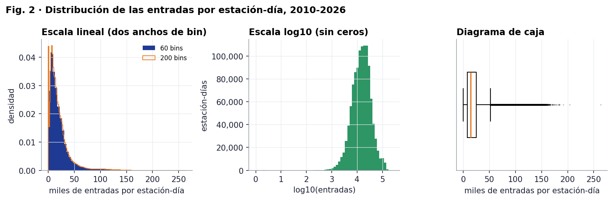

La **Fig. 2** completa la descriptiva: en escala lineal la distribución es una rampa pegada al cero con una cola hasta 263 mil. En escala log10 se vuelve casi simétrica alrededor de 4.2 (unas 15 mil entradas). La caja muestra la cantidad de valores por encima de 1.5 × IQR: son estaciones grandes, no errores.

## Fuentes de los eventos citados

- Gratuidad del transporte tras el sismo del 19-S hasta el 27 de septiembre de 2017: [Eje Central](https://www.ejecentral.com.mx/miercoles-ultimo-dia-de-gratuidad-en-transporte-capitalino?p=7).
- Gratuidad por la contingencia ambiental de marzo de 2016: [Quadratín](https://mexico.quadratin.com.mx/Metro-%C2%A0Metrobus-RTP-y-Transportes-electrico-gratis-por-Contingencia) y [Chilango](https://www.chilango.com/ciudad/metrobus-gratis-por-contingencia-ambiental/).
- Incendio del Puesto Central de Control (9 de enero de 2021) y reapertura de la Línea 1 el 25 de enero: [Chilango](https://www.chilango.com/noticias/abren-la-linea-1-del-metro-cdmx/).
- Escala de lluvia del SMN para 24 h: [Milenio](https://www.milenio.com/comunidad/que-significan-25-50-o-150-mm-de-lluvia-pronostico-smn).
