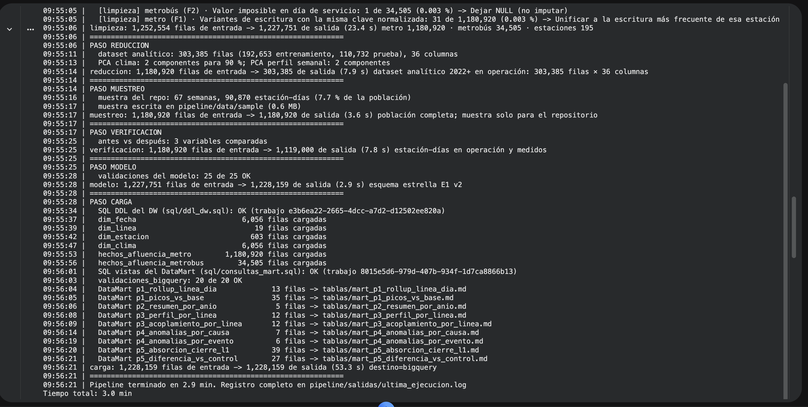
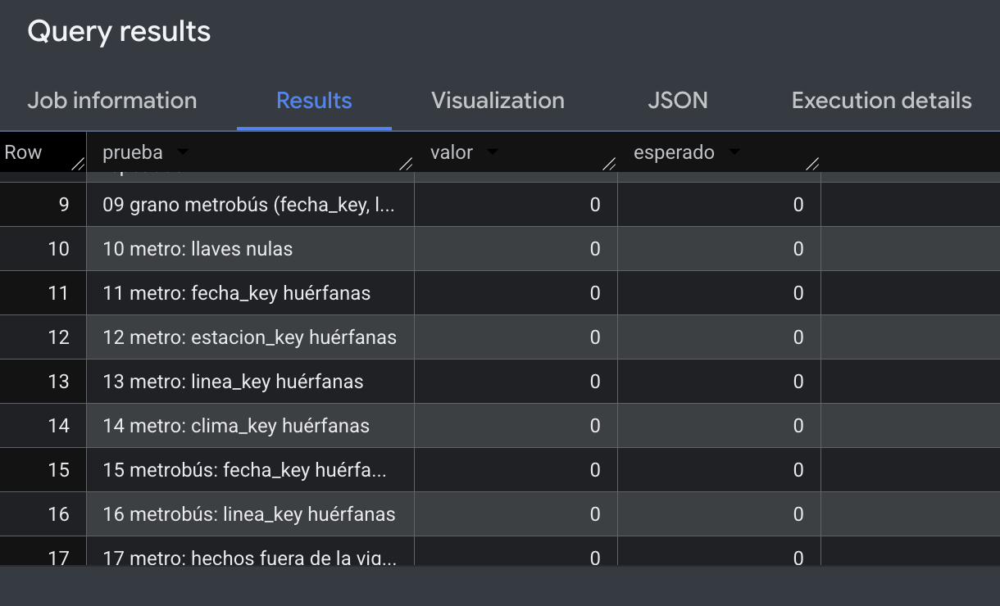
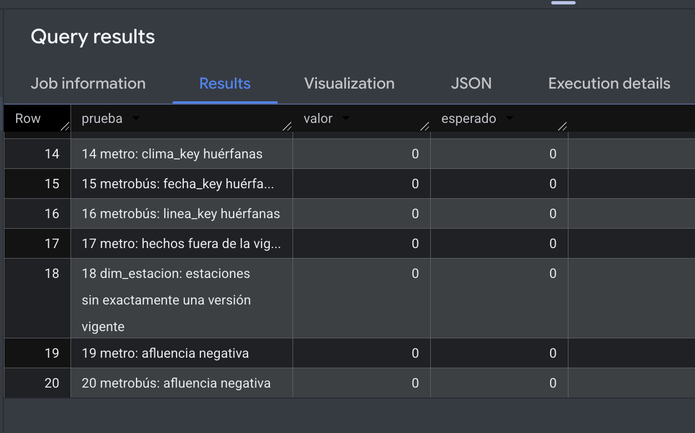
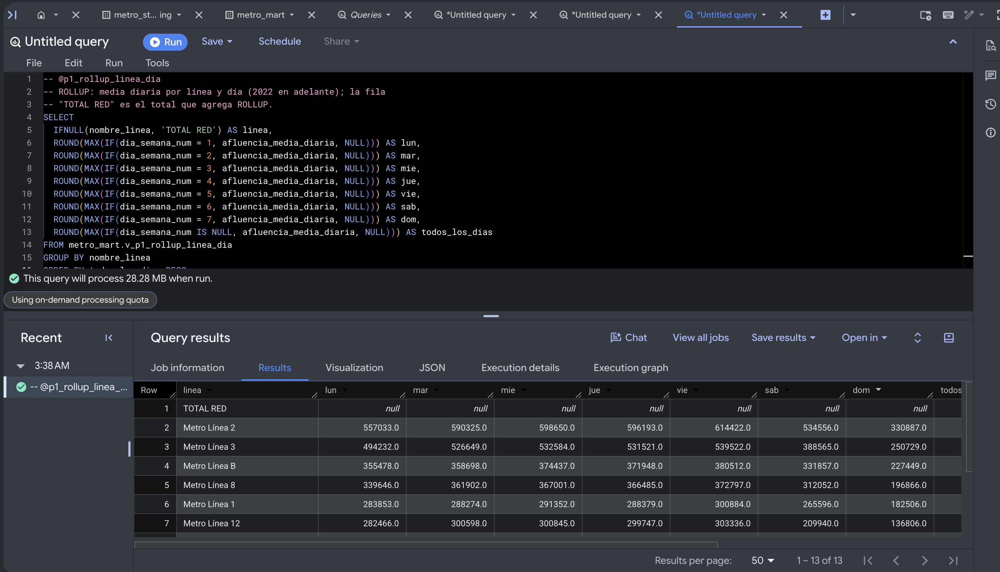
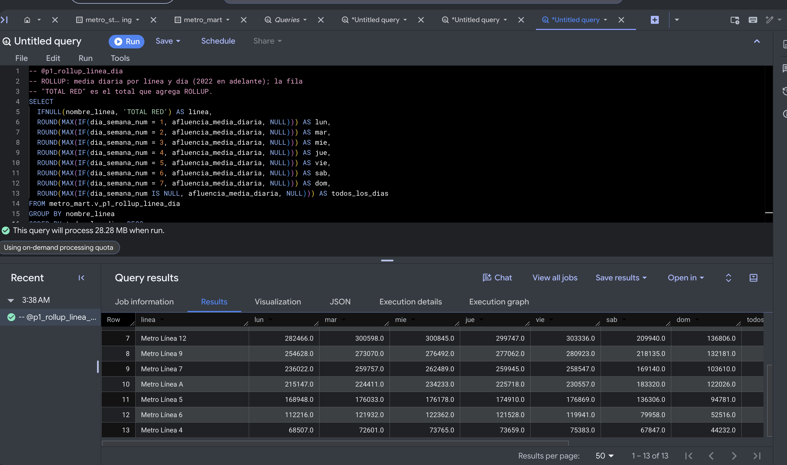
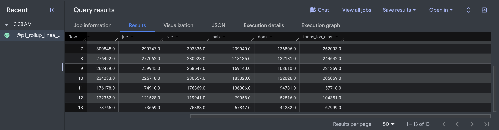
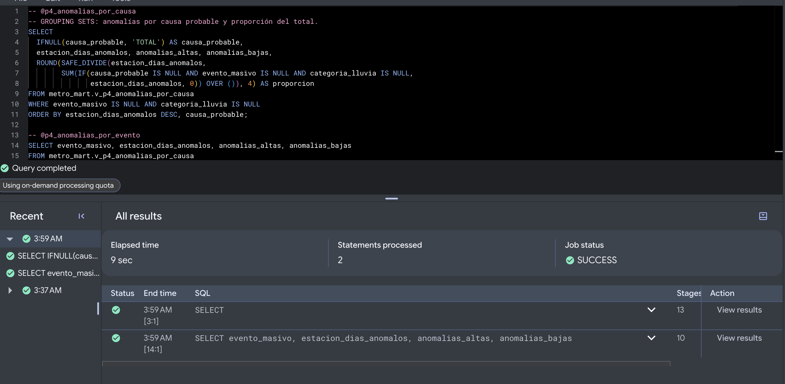
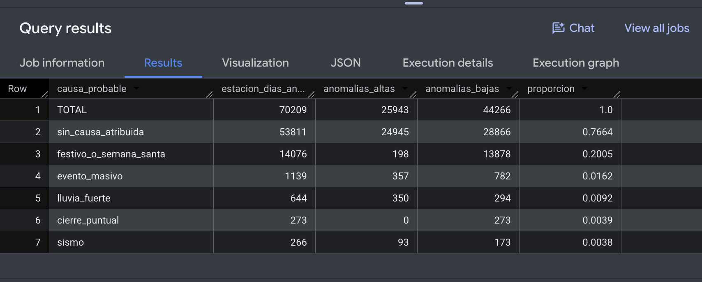
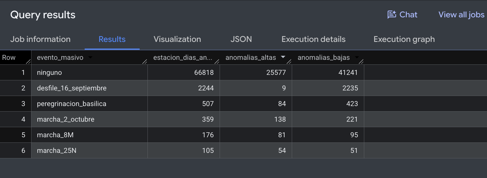

## 3.1 Arquitectura

Un solo punto de entrada lleva los datos de la capa **staging** (intacta desde E1) al **esquema estrella** poblado y ejecuta el **DataMart**. El código está en [`pipeline/`](https://github.com/Fernando-BM/Proyecto_Mineria_Datos/tree/main/pipeline) y el SQL en [`sql/`](https://github.com/Fernando-BM/Proyecto_Mineria_Datos/tree/main/sql).

```{mermaid}
flowchart LR
    S[("metro_staging<br/>7 tablas crudas")] --> I["1 · ingesta"]
    I --> C["2 · calidad<br/>diagnóstico y EDA"]
    C --> L["3 · limpieza<br/>registro L01-L26"]
    L --> R["4 · reducción<br/>χ², Spearman, PCA"]
    R --> M["5 · muestreo<br/>muestra del repo"]
    M --> V["6 · verificación<br/>antes vs. después"]
    V --> K["7 · carga<br/>modelo + validaciones"]
    K --> D[("metro_dw<br/>2 hechos + 4 dims")]
    D --> X[("metro_mart<br/>8 vistas")]
    C -. tablas y figuras .-> W["sitio Quarto<br/>entregas/E2/"]
    K -. resultados .-> W
```

| Paso | Módulo | Entrada → salida | Qué produce |
|------|--------|------------------|-------------|
| ingesta | `src/ingesta.py` | staging → dataframes de texto | Lee las 7 tablas con `list_rows`, que no cobra bytes escaneados. Sube a staging la fuente nueva de sismos (F6) |
| calidad | `src/calidad.py` | crudo → dataset analítico crudo | Tablas `eda_*`, figuras 1-14 |
| limpieza | `src/limpieza.py` | crudo → limpio | `registro_limpieza` (26 entradas), versiones SCD2, marcas de atípicos |
| reducción | `src/reduccion.py` | limpio → dataset de modelado 2022+ | χ², Spearman, PCA (solo con entrenamiento), tabla de decisión |
| muestreo | `src/muestreo.py` | población → muestra del repo | `data/sample/` y prueba de representatividad |
| verificación | `src/verificacion.py` | crudo vs. limpio | Tablas antes/después, Fig. 17 |
| carga | `src/modelo_dw.py`, `src/carga.py` | limpio → `metro_dw` → `metro_mart` | DDL v2, carga de las 6 tablas, vistas, validaciones SQL y resultados del DataMart |

### Requisitos que cumple

| Requisito | Cómo |
|-----------|------|
| Un solo punto de entrada | `python pipeline/run_pipeline.py` (o el cuaderno `pipeline/ejecutar_en_colab.ipynb`) |
| Pasos separados y nombrados | Un módulo por paso; cada uno registra filas de entrada y salida |
| Sin pasos manuales | La fuente nueva (sismos) la sube el propio pipeline; el DDL, las vistas y las validaciones se ejecutan desde el código. No se edita nada a mano |
| Idempotente | `DROP` + `CREATE OR REPLACE` en el DDL y en las vistas. Dos corridas seguidas dejaron tablas, figuras y muestra **idénticas byte por byte** (comparadas con MD5); solo cambia la columna de segundos del registro de pasos |
| Semilla fija | `semilla: 20261106` en `config.yaml` |
| Versiones fijadas | `pipeline/requirements.txt` (pandas 2.2.3, numpy 2.1.3, scikit-learn 1.6.1, google-cloud-bigquery 3.27.0, …) |
| Rutas relativas y parámetros en configuración | `config.yaml`: umbrales, semilla, nombres de datasets y tablas, rutas |
| Registro por paso | `tablas/registro_pasos.md` y `pipeline/salidas/ultima_ejecucion.log` |
| Validaciones automáticas | 25 `assert` en pandas (modelo) y 20 pruebas SQL en BigQuery; cualquier falla detiene la corrida |
| Credenciales | Ninguna en el repositorio: ADC, inicio de sesión de Colab o pydata-google-auth (token fuera del repo). `.gitignore` excluye `*.json` |
| Datos grandes | El CSV de 60 MB vive en BigQuery y en `datos/crudos/` (ignorado). En el repositorio solo está la muestra de 0.6 MB |

**Tabla 24.** Registro por paso de la última corrida.



**Tabla 25.** Huella de los archivos de origen (SHA-256, riesgo R2 de E0: si el portal corrige datos hacia atrás, la huella cambia).



## 3.2 Cómo se ejecuta

Las instrucciones completas (instalación, autenticación y tiempos) están en el [README del pipeline](https://github.com/Fernando-BM/Proyecto_Mineria_Datos/blob/main/pipeline/README.md). En resumen:

```bash
pip install -r pipeline/requirements.txt
python pipeline/run_pipeline.py                                  # oficial: BigQuery -> BigQuery (5 a 10 min)
python pipeline/run_pipeline.py --fuente local --destino local   # archivos del portal, sin credenciales (~30 s)
python pipeline/run_pipeline.py --fuente muestra                 # muestra del repo, sin credenciales (~10 s)
```

En los dos modos sin credenciales, el pipeline también ejecuta las vistas del DataMart y las validaciones SQL **en DuckDB**, traduciendo el mismo SQL de BigQuery con sqlglot. Así la ayudantía puede comprobar todo de punta a punta sin acceso al proyecto.

## 3.3 DW poblado

El modelo es el de E1 con los ajustes documentados en [Ajustes a E1](ajustes.qmd) (E1 v2).

**Tabla 26.** Filas por tabla del DW.



- **`dim_estacion`** tiene **603 versiones** para 195 estaciones-línea (SCD tipo 2): 389 en `operando`, 194 en `cerrada` y 20 en `no_inaugurada`. La estación con más historia es Zócalo/Tenochtitlan, con 19 versiones por sus cierres para eventos.
- **`dim_fecha`** marca 119 festivos de ley, 34 días de Semana Santa, 27 días con sismo, 81 días con evento masivo y 10 días sin medición.
- **`hechos_afluencia_metro`** tiene exactamente 6,056 días × 195 = 1,180,920 filas; 1,950 tienen afluencia NULL (días sin medición).

### Evidencia de consistencia

**Tabla 27.** Validaciones del modelo en pandas (antes de cargar).



**Tabla 28.** Validaciones en BigQuery después de cargar (`sql/validaciones_dw.sql`): conteo de filas por tabla, unicidad del grano, llaves nulas, llaves huérfanas, vigencia SCD2 y rangos.



**Corrida oficial.** El 15 de noviembre de 2026, en Google Colab (Python 3.13), la corrida `--fuente bigquery --destino bigquery` tardó unos 3 minutos: casi todo se va en la ingesta (55 s) y en la carga (53 s). Las 20 validaciones dieron OK y el DW quedó con 603 versiones de estación, igual que en la corrida local.

::: {layout-ncol=2}






:::

**Verificación cruzada local ↔ BigQuery.** El pipeline corre igual con los archivos del portal (`--fuente local`) y con la capa staging de BigQuery, así que comparamos las dos salidas tabla por tabla. En la primera corrida en BigQuery apareció una diferencia: `dim_estacion` tenía **604** versiones, contra 603 en local. La causa fue el nombre "Miguel Ángel de Quevedo" de julio de 2026 (31 filas). En el CSV original trae la doble codificación con un carácter de control (U+0081). Al cargar el CSV en staging (E1), BigQuery alteró ese carácter (reemplazarlo en la copia local reproduce exactamente las 31 filas y la versión de más), la reparación de codificación ya no pudo revertirlo, y la estación quedó repetida con otro nombre. Las 20 validaciones habían pasado, porque cada día seguía teniendo 195 filas únicas. Se agregó una regla general (registro L26: unificar dentro de cada línea los nombres con la misma clave normalizada) y se volvió a correr. En la segunda corrida la regla unificó esas 31 filas, y **el DW, las validaciones y los 9 resultados del DataMart salen idénticos a los de la corrida local**. Solo cambian, como se espera, las tablas del EDA sobre datos *crudos*, que se calculan antes de limpiar: en BigQuery muestran esa estación repetida en 2026 (por ejemplo, 196 estaciones con entradas en la Tabla 6). Las tablas publicadas en el sitio son las de BigQuery.

## 3.4 Resultados del DataMart

Las 8 vistas del DataMart (las 7 de E1, ajustadas, más una nueva para P5) se ejecutan sobre el DW poblado. Cada resultado se lee contra su pregunta, como pidió la retroalimentación de E1. Las consultas que se publican están en `sql/resultados_mart.sql`, y cada resultado se escribe en `tablas/mart_*.md`.

### P1 · ROLLUP por línea y día de la semana



::: {layout-ncol=2}






:::

**Lectura.** Desde 2022 la red recibe en promedio **3.16 millones de entradas al día** (fila TOTAL RED, que agrega el ROLLUP). La Línea 2 es la más cargada (546 mil por día) y la 4 la más ligera (68 mil). Todas las líneas bajan el domingo, pero con distinta intensidad: la Línea 3 cae al 46 % de su viernes y la Línea 4 solo al 59 %. Ese dato sirve para P3.

### P1 · Ventanas: estaciones pico contra su propia base



**Lectura.** Constitución de 1917 (L8) es la estación más cargada todos los días entre semana: de 96 mil entradas el lunes a 104 mil el viernes. Le siguen Indios Verdes (L3) y Cuatro Caminos (L2). El `indice_vs_base` muestra qué tan por encima de su propio promedio semanal está cada día. Universidad (L3) llega a 1.20 entre semana: es la estación más dependiente del calendario laboral y escolar entre las grandes.

### P2 · Conjunto de pronóstico y línea base ingenua



**Lectura.** Cada año aporta entre 62 y 70 mil estación-días en operación. La proporción de alta demanda baja de 10.8 % (2022) a 7.3 % (2025). La **línea base ingenua** se equivoca, en total, un **10.7 %** de las entradas en 2025 (WAPE), con un error mediano de 5.8 % por estación-día. Esa es la vara: el criterio de éxito de E0 pide reducir el error en al menos 20 %, es decir, un WAPE de alrededor de 8.6 % o menos en el periodo de prueba.

### P3 · PIVOT del perfil semanal (promedio por línea)



**Lectura.** En la Línea B el domingo pesa 10.0 % de la semana y en la Línea 7 solo 7.1 %. Es el mismo eje "paseo vs. trabajo" del PCA (CP1). La matriz completa (195 estaciones × 7 días) es la entrada del clustering de E3.

### P3 · Acoplamiento Metro ↔ Metrobús (correlación sin ciclo semanal)



**Lectura.** La correlación de los niveles (`bruta_min` a `bruta_max`) va de 0.50 a 0.96 para casi cualquier par, porque todas las líneas suben entre semana y bajan el domingo. **No sirve para elegir alternativas**, así que la vista ahora también correlaciona la *desviación* de cada día contra lo esperado para ese día de la semana (columnas `sin_ciclo`). Esa correlación mide si dos líneas reciben los mismos choques inesperados: vacaciones, marchas, lluvia o un cierre.

El resultado es igual para las 12 líneas del Metro:

- La **Línea 2 del Metrobús** (Tepalcates–Tacubaya) es siempre la **más acoplada** (0.61 a 0.78). Cuando una línea del Metro tiene un día inesperadamente cargado, ella también. Por eso es mala alternativa: se satura al mismo tiempo.
- La **Línea 4 del Metrobús** (Centro Histórico–San Lázaro–Aeropuerto–Pantitlán) es siempre la **menos acoplada** (0.12 a 0.32). Su demanda tiene dinámica propia, por el aeropuerto y el turismo, y tiende a tener margen justo cuando el Metro se satura.

Su menor acoplamiento es con la **Línea 1** (0.117), que también conecta San Lázaro con Pantitlán. Es también la línea que mejor se comportó como "absorbente" en P5 (abajo).

**Respuesta a P3 (ajustada):** la alternativa de Metrobús con mejor evidencia es la Línea 4, sobre todo para la Línea 1 del Metro. Para las demás líneas, el acoplamiento no las distingue entre sí: elegir la alternativa de cada perfil necesita la cercanía geográfica (coordenadas de F3), que se cruza en E3.

### P4 · Anomalías por causa probable (GROUPING SETS)





::: {layout-ncol=3}





:::

**Lectura.** Con |z| ≥ 3 contra las 8 semanas previas, 70 mil estación-días (6 % de los días en operación) son anómalos. Los **festivos y Semana Santa explican el 20 %**, casi todos a la baja. Los **eventos masivos** nuevos explican 1.6 %; el desfile del 16 de septiembre es el que más pesa, aunque también es festivo. La lluvia fuerte explica 0.9 % y los sismos 0.4 %. El **77 % queda sin causa atribuida**. Buena parte son semanas de vacaciones escolares y de fin de año que no son festivos, así que el calendario escolar es la siguiente fuente a buscar para E3. P4 sigue **parcial**, ahora con números.

### P5 · Cierre de la Línea 1 (CUBE)



**Lectura.** La Línea 1 bajó de 426 mil a 210 mil entradas diarias durante la obra y subió a 450 mil al reabrir. El Metrobús pasó de 156 mil a 200 mil entradas por línea al día (+28 %). Pero el CUBE solo da promedios: el resto de la red también creció en esos años por la recuperación posterior a la pandemia, y con eso no basta para decir que el Metrobús *absorbió* a los usuarios de la Línea 1. Por eso se agregó la vista siguiente.

### P5 · Diferencia contra un grupo de control (ventanas)



**Lectura.** El **control** son las 10 líneas del Metro que siguieron abiertas (todas menos la 1 y la 12). Crecieron **20.1 %** durante el cierre, por la recuperación y la estacionalidad, y bajaron 4.1 % al reabrir la Línea 1. La columna `diferencia_vs_control` resta ese cambio. Una línea que absorbe usuarios debería quedar **por encima del control durante el cierre y por debajo al reabrir**:

| Línea de Metrobús | Durante vs. control | Al reabrir vs. control | Lectura |
|---|---|---|---|
| **L4** (Centro–San Lázaro–Pantitlán) | +12.9 pp | **−16.1 pp** | Patrón completo de absorción: ganó usuarios con el cierre y los devolvió al reabrir |
| **L2** (Tepalcates–Tacubaya) | +14.6 pp | −3.2 pp | Absorción parcial: devolvió una parte |
| L1, L3, L5, L6 | +3 a +13 pp | +6 a +8 pp | Siguieron creciendo después de reabrir: su aumento es crecimiento propio, no absorción |
| L7 (Reforma) | −10.2 pp | −14.8 pp | Perdió en ambos periodos: su caída no se explica por la Línea 1 |

*pp = puntos porcentuales.*

**Respuesta a P5:** sí hay absorción medible, concentrada en la **Línea 4 del Metrobús** y, en menor medida, en la **Línea 2**. Las demás crecieron por su cuenta. El periodo "antes" es solo el primer semestre de 2022 (en E1 empezaba en 2019; se ajustó porque la pandemia simulaba absorción, ver [Ajustes](ajustes.qmd)). La comparación contra el control corrige la recuperación de la pandemia, pero no las diferencias de estacionalidad entre un semestre y varios años completos. P5 pasa de "parcial" a **"cubierta con una limitación"**.

## 3.5 Prueba externa

Un integrante que **no** escribió el pipeline lo ejecuta desde un clon limpio y registra el resultado.

| Fecha | Integrante | Entorno | Comando | Tiempo | Resultado | Observaciones |
|-------|------------|---------|---------|--------|-----------|---------------|
| [por llenar]{.todo} | [por llenar]{.todo} | [Colab / Mac / Windows]{.todo} | `--fuente muestra` | [ ]{.todo} | [ ]{.todo} | [ ]{.todo} |
| [por llenar]{.todo} | [por llenar]{.todo} | [Colab]{.todo} | `--fuente bigquery --destino bigquery` | [ ]{.todo} | [ ]{.todo} | [ ]{.todo} |
