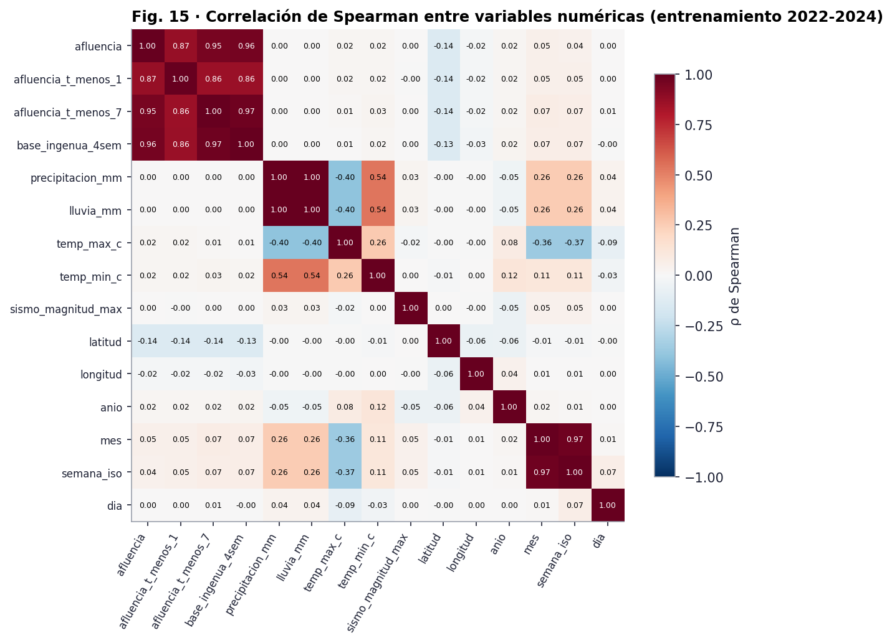
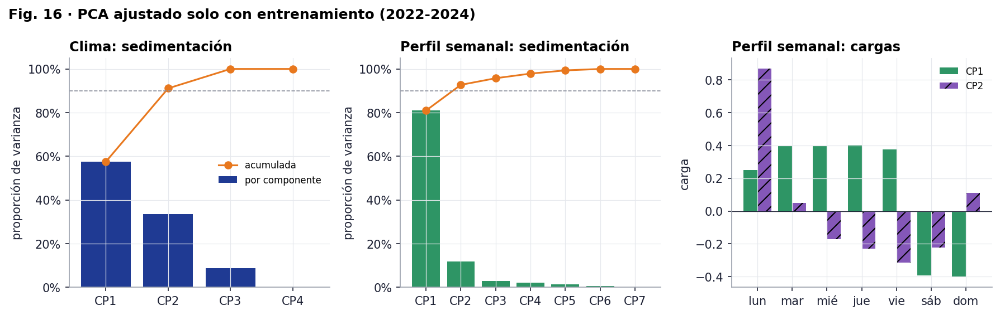
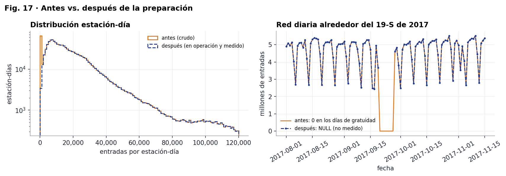

Esta página cubre la fase de **preparación** de CRISP-DM: limpieza, reducción de dimensionalidad, muestreo y la verificación de que la preparación no borró el fenómeno de E0. Cada decisión la toma el código del [pipeline](pipeline.qmd), y el registro se genera solo en cada corrida. La versión en lenguaje no técnico está en [Decisiones](decisiones.qmd).

## 2.1 Calidad de los datos y tratamiento del ruido

Primero se diagnosticó (Tabla 1 del [EDA](eda.qmd#diagnóstico-inicial-de-calidad)) y después se decidió. **Nada se eliminó ni se imputó en silencio:** cada tratamiento llama a una función de registro con su conteo y su justificación.

### Registro de limpieza

**Tabla 13.** Registro de limpieza generado por el pipeline (`tablas/registro_limpieza.csv`).



### Criterios por tipo de problema

| Problema | Dónde | Tratamiento | Por qué así y no de otra forma | Qué pasa con E0 |
|----------|-------|-------------|--------------------------------|-----------------|
| **Faltantes estructurales** | Metrobús: 7,887 'NaN' antes de que existiera cada línea (L24) | Excluir la fila | Los 'NaN' **todos** son anteriores al primer dato de su línea (el pipeline lo comprueba con un `assert`): no es un dato perdido sino una línea que no existía. Imputar inventaría pasajeros | Ninguna pérdida para P3 y P5 |
| **Faltantes disfrazados de cero** | Metro: 10 días en que toda la red registra menos del 10 % de su nivel (L17) | Afluencia **NULL** y `es_dia_sin_medicion` en `dim_fecha` | El transporte fue gratuito y los torniquetes no contaron: el cero no es demanda. No se imputa porque nadie sabe cuánta gente viajó, y la regla (red < 10 % de la mediana del mismo día en las 4 semanas previas) no confunde ningún festivo: el día más bajo que no es de gratuidad queda en 25 % | P2 no aprende que un sismo vacía el Metro; P4 no cuenta estos días como anomalías |
| **Ceros estructurales** | L12 antes de abrir (20,780) y cierres de 7 días o más (39,190) (L18, L19) | Conservar el 0 y crear una **versión SCD2** de la estación (`no_inaugurada` o `cerrada`) | El 0 es verdadero: la estación no operó. Imputar fingiría servicio; borrar perdería la historia que necesitan P4 y P5 | P2 entrena solo con días en `operando` (riesgo R3); P5 usa los cierres como cuasiexperimento |
| **Ceros puntuales** | 477 estación-días con menos de 7 días seguidos en cero (L20) | Conservar con `es_registro_cero` | Son cierres de un día por marchas y eventos: el fenómeno de P4 | P4 los atribuye a `cierre_puntual` |
| **Duplicados exactos** | Ninguno (L14) | — | Se comprobó | — |
| **Duplicados de llave natural** | 31 pares "Oceanía" en la Línea B, diciembre de 2020 (L15) | El valor mayor de cada par pasa a "Deportivo Oceanía" | Ese mes falta justo esa estación. En 2019 Deportivo Oceanía supera a Oceanía el 100 % de los días, y el 97 % en octubre-noviembre de 2020. La regla no depende del orden de las filas, que BigQuery no garantiza | El grano vuelve a ser único (195 por día) |
| **Atípicos** | 18,553 estación-días con \|z robusto\| ≥ 3.5 (L21) | **Conservar** el valor y marcar `es_atipico` | El z robusto compara contra la mediana del mismo día de la semana en las 9 semanas alrededor, con la MAD como escala (y un piso del 10 % de la mediana para no marcar variaciones de ±15 % en estaciones muy estables). Los altos son peregrinaciones y eventos; los bajos, festivos y vacaciones. Son exactamente los días que P4 quiere explicar y que P2 quiere anticipar | Ningún valor cambia; la marca se usa para describir, no para predecir (ver fuga en 2.2) |
| **Valor imposible** | Metrobús L2, 2017-09-20: 9 entradas (L25) | NULL | En un día de servicio con mediana de unos 135 mil, 9 es un error de conteo (era un día de gratuidad) | Una fila de 34,505 |
| **Inconsistencias de categorías** | 24 textos de línea, 14 del Metrobús, 2 estaciones escritas de dos formas (L10-L13, L22) | Reparar la codificación y mapear a un catálogo canónico (`config.yaml`) | La regla latin-1 → utf-8 solo se aplica a textos con la marca de doble codificación ('Ã'), así que no puede dañar un nombre correcto | Las agregaciones por línea y estación de P1 a P5 se vuelven confiables |
| **Tipos, unidades y rangos** | Fechas, enteros, clima (L03, L04, L07, L08) | Ninguna acción | Todo pasó las reglas: fechas ISO, afluencia ≥ 0, precipitación ≥ 0, mínima ≤ máxima, temperaturas entre −15 y 45 °C | — |
| **Fechas legales vs. F4** | 10 festivos que Nager.Date recorre (L01) | La fecha la decide el art. 74 de la LFT; F4 solo valida | La ley no recorre el 1 de enero ni el 1 de mayo cuando caen en fin de semana | `es_festivo_oficial` correcto para P4 |
| **Llaves que no coinciden** | 8 de 195 estaciones no unen con el GTFS por nombre (L16) | Tabla de equivalencias en `config.yaml` | 187 unen por nombre normalizado; los 8 restantes son nombres compuestos ("Garibaldi/Lagunilla" vs. "Garibaldi y Lagunilla"). No se pierde ninguna fila | Coordenadas completas para P3 |
| **Periodo fuera de alcance** | Metrobús 2005-2009 (L23) | Excluir | El DW cubre 2010-2026 porque Metro y clima empiezan ahí. Incluye el primer día de la serie, con 3 millones de entradas en una línea (error evidente) | P3 y P5 solo comparan días en común |

## 2.2 Reducción de dimensionalidad

**Criterio explícito, fijado antes de ver los resultados** (`config.yaml`):

1. **Chi-cuadrada** de cada variable categórica contra la etiqueta `es_alta_demanda`. Con n = 192 mil cualquier diferencia resulta significativa, así que se exigen dos condiciones: **p ajustada por Bonferroni < 0.01** y **V de Cramér ≥ 0.10** (efecto pequeño según Cohen). Si una variable es significativa pero con V < 0.10, se conserva **solo si una pregunta de E0 la necesita** ("Conservar (dominio)"); si no, se descarta como predictor.
2. **Correlación de Spearman** entre numéricas. Con **|ρ| ≥ 0.90** dos variables son redundantes y se queda la que está ligada al criterio de éxito o la más interpretable.
3. **PCA** sobre las numéricas estandarizadas, con objetivo de **90 % de varianza acumulada**. Se conservan las originales si las componentes no reducen de forma útil o hacen perder la interpretación.

**Sin fuga de información.** El dataset de modelado (2022-2026, solo días en `operando`, 303 mil estación-días) se parte por fecha: **entrenamiento hasta 2024-12-31** y prueba de 2025 en adelante. Los cortes de discretización (cuartiles de temperatura), la estandarización y los dos PCA se **ajustan solo con entrenamiento**. La base ingenua y los rezagos usan únicamente días anteriores a cada fecha. No se sobremuestrea nada. La partición definitiva se hará en el modelado, y el pipeline ya deja el mecanismo listo (`fin_entrenamiento`).

### Chi-cuadrada y V de Cramér

**Tabla 14.** Variables categóricas contra la etiqueta de alta demanda (entrenamiento, 192,653 estación-días). Todas cumplen la condición de frecuencia esperada ≥ 5 por celda.



Solo el **mes** supera los dos umbrales (V = 0.154). La alta demanda se concentra en enero (19 % de los estación-días), febrero (16 %) y abril (14 %), y es mínima en junio y julio (3-5 %). Son los **regresos de vacaciones**: la base de 4 semanas todavía incluye días de diciembre o de Semana Santa, así que el primer mes "normal" la supera. Es una pista para E3: un calendario escolar, que ninguna fuente abierta trae por día, explicaría buena parte de la etiqueta. El **día de la semana** queda en V = 0.089, como era de esperar: la etiqueta ya compara cada día contra el mismo día de la semana. El **sismo** es la única variable sin asociación (p ajustada = 1). Sale del modelo, pero se queda en el DW como causa candidata de anomalías (P4).

### Correlación

**Tabla 15.** Pares con |ρ| ≥ 0.90.



La **Fig. 15** muestra tres bloques. (1) Las variables de demanda (afluencia, rezagos y base) se correlacionan entre 0.86 y 0.97 porque el tamaño de la estación domina todo. (2) La precipitación y la lluvia son **la misma variable** (ρ = 1.00). (3) El mes y la semana ISO son casi la misma (0.97). De la Tabla 15 salen tres decisiones: se descarta `lluvia_mm`, se descarta `semana_iso` y se combina `afluencia_t_menos_7` con la base (es uno de los cuatro valores que la base promedia). Los pares con la propia afluencia no son redundancia entre predictores sino relación con el objetivo, que es justo lo que se busca.

**Tabla 16.** Relación con el objetivo en escala relativa (cociente afluencia / base), para que el tamaño de la estación no domine.



En escala relativa, los rezagos siguen aportando (ρ ≈ 0.29-0.31) y el clima casi nada (|ρ| < 0.06). Esto confirma el resultado negativo del EDA (H3).

### PCA

**Tabla 17.** PCA del clima (4 variables estandarizadas, días de entrenamiento).





**CP1** (57 %) es "día de lluvia": cargan la precipitación, la lluvia y la temperatura mínima (las noches nubladas son menos frías), y la máxima en sentido contrario. **CP2** (34 %) es "nivel de temperatura". Dos componentes alcanzan el 91 %. La **CP4 tiene varianza 0**, la huella algebraica de que precipitación y lluvia son idénticas. **Decisión:** conservar las originales. Al quitar `lluvia_mm` quedan 3 variables, así que pasar a 2 componentes casi no ahorra nada y se pierde la interpretación.

**Tabla 18.** PCA del perfil semanal de las 195 estaciones (participación de cada día; entrada del clustering de P3).





**CP1** (81 %) contrapone lunes-viernes (cargas positivas) contra sábado-domingo (negativas): es el eje "estación de trabajo vs. estación de paseo" que la entropía del EDA ya sugería. **CP2** (12 %) separa el lunes del viernes. Con dos componentes se explica el 93 %. **Decisión:** conservar las 7 participaciones en el DataMart (`v_p3_perfil_semanal_estacion`) y dejar documentado que en E3 el clustering se probará sobre las 2 componentes y sobre las 7 participaciones.

### Tabla de decisión por variable

**Tabla 19.** Todas las variables del dataset analítico y del DW, con su decisión.



## 2.3 Muestreo

**Tabla 20.** Decisión de muestreo.



**No se muestrea.** La población completa (1.18 millones de estación-días) cabe en memoria, el pipeline completo tarda menos de un minuto en local, y BigQuery la procesa dentro de la capa gratuita (la tabla de staging pesa unos 60 MB y la ingesta con `list_rows` no cobra bytes escaneados). No hay una clase a balancear porque en E2 no se entrena. Tampoco hay redundancia que resumir, porque cada fila es un estación-día distinto.

**Muestra del repositorio.** GitHub no debe alojar el CSV de 60 MB, y la ayudantía necesita poder correr el pipeline sin credenciales. Por eso se versiona una muestra pequeña en `pipeline/data/sample/` (0.6 MB):

- **Población:** estación-días medidos de 2010-2026.
- **Método:** estratificado por año y trimestre, con **una semana completa (lunes a domingo) por estrato** elegida al azar. Se usan bloques de semanas completas para no romper el orden de la serie ni el ciclo semanal; un muestreo aleatorio simple de filas dejaría semanas sin sábado o sin domingo.
- **Tamaño:** 67 semanas, 90,870 estación-días (7.7 %). Se descartó una semana por mes porque la muestra pesaría 3 veces más sin ganar cobertura de días de la semana.
- **Semilla fija:** `20261106` (`config.yaml`).

**Tabla 21.** Representatividad de la muestra frente a la población.



**Lectura.** La afluencia de la muestra tiene una distribución prácticamente igual a la de la población. El estadístico KS es de 0.007 (las funciones de distribución difieren en menos de un punto porcentual) y la media difiere 0.9 %. El p-valor es pequeño solo porque n = 90 mil hace significativa cualquier diferencia. La precipitación (KS p = 0.52), el día de la semana (χ² p = 0.60), la categoría de lluvia (p = 0.39) y la línea (idéntica por diseño) no muestran diferencias. El **año** sí difiere (p < 0.001), y es **por diseño**: cada año aporta las mismas semanas aunque 2026 solo tenga siete meses de datos. La muestra sirve para probar el pipeline, no para estimar totales anuales, y así se declara.

## 2.4 Verificación: antes vs. después

**Tabla 22.** Medidas clave antes y después de la preparación. "Después" incluye solo los estación-días medidos y en operación, que es lo que verá el modelado.



**Tabla 23.** ¿Se conservó el fenómeno de E0?



**Conclusión: la preparación conservó el fenómeno.**

- La **concentración** que define a P1 no se movió: Gini de 0.377 y top 10 % = 28.6 %, iguales antes y después, con las mismas 5 estaciones a la cabeza.
- El **patrón semanal** tampoco: domingo = 51 % de un día laboral y entropía por día de la semana de 0.990.
- La afluencia estación-día perdió casi todos sus ceros (de 5.3 % a 0.04 %, los cierres de un día que se conservan a propósito). Su mediana subió de 14,426 a 15,297 y la asimetría casi no cambió (2.59 → 2.65): la cola derecha, donde viven los picos, está intacta porque ningún atípico se eliminó.
- La red diaria pierde los 10 días sin medición (Fig. 17, derecha): ya no hay un "0" artificial en septiembre de 2017, y su asimetría pasa de −0.44 a −0.42.
- En el Metrobús la asimetría baja de 1.78 a 1.49 porque se fue el valor de 3 millones del 26 de julio de 2005.

El hallazgo principal del EDA (H1: concentración estable en pocas terminales) **no desapareció**, así que no hay señal de alerta.
